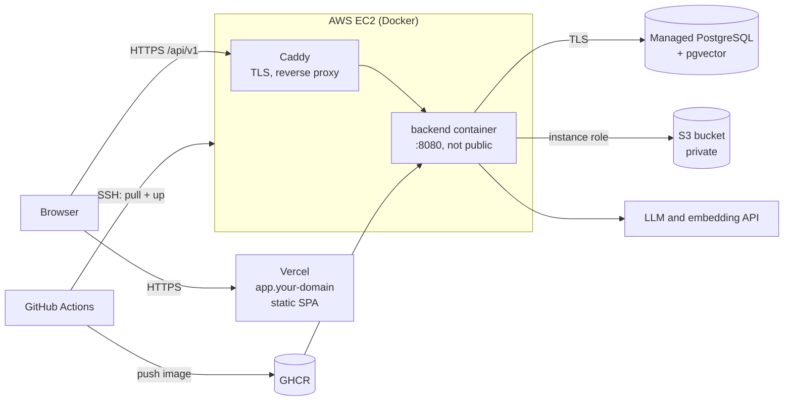

# HireFlow AI — Deployment

How to run HireFlow AI locally, how it is configured, and how it is built, tested and deployed to production.

## Contents

1. [Environments](#1-environments)
2. [Prerequisites](#2-prerequisites)
3. [Local development](#3-local-development)
4. [Configuration](#4-configuration)
5. [Containers](#5-containers)
6. [Production topology](#6-production-topology)
7. [Domains, HTTPS, CORS and cookies](#7-domains-https-cors-and-cookies)
8. [Database in production](#8-database-in-production)
9. [CI/CD](#9-cicd)
10. [First production deployment](#10-first-production-deployment)
11. [Routine deploys and rollback](#11-routine-deploys-and-rollback)
12. [Observability](#12-observability)
13. [Cost and abuse controls](#13-cost-and-abuse-controls)
14. [Pre-launch checklist](#14-pre-launch-checklist)

---

## 1. Environments

| Environment | Frontend | Backend | Database | Files | AI |
|---|---|---|---|---|---|
| **Local** | Vite dev server `:5173` | `./mvnw spring-boot:run` `:8080` | Docker `pgvector/pgvector:pg17` | Local directory | Real provider key, or mocked |
| **CI** | `npm run build` | `./mvnw verify` | Testcontainers | Temp directory | Always mocked |
| **Production** | Vercel | Docker container on AWS EC2 behind Caddy | Managed PostgreSQL with pgvector | S3 (private bucket) | Real provider key |

Spring profiles: `local`, `test`, `prod`, plus an optional `demo` profile that seeds demo data.

---

## 2. Prerequisites

| Tool | Version | Notes |
|---|---|---|
| JDK | 21 or newer | The build targets Java 21 (`maven.compiler.release=21`); JDK 23 works |
| Maven | via `./mvnw` | The wrapper pins the version |
| Node.js | 22 LTS | |
| Docker | Docker Desktop or OrbStack | **Required** for local Postgres, Testcontainers and building images |
| AWS CLI, GitHub CLI | latest | Only for deployment |

---

## 3. Local development

```bash
# 1. Configuration
cp .env.example .env                      # fill in AI keys; local defaults work for the rest

# 2. Database (Postgres 17 + pgvector)
docker compose up -d postgres

# 3. Backend — Flyway migrates on startup
cd backend
./mvnw spring-boot:run -Dspring-boot.run.profiles=local,demo
# API:        http://localhost:8080/api/v1
# Swagger UI: http://localhost:8080/swagger-ui.html
# Health:     http://localhost:8080/actuator/health

# 4. Frontend
cd frontend
npm install
npm run dev                               # http://localhost:5173 — /api is proxied to :8080
```

The Vite dev server proxies `/api` to `localhost:8080`, so the browser sees a single origin locally and CORS and cookie settings don't get in the way.

**Full stack in containers** (closest to production):

```bash
docker compose --profile full up --build
```

**Reset the local database:** `docker compose down -v && docker compose up -d postgres`.

**Demo data:** the `demo` profile runs an idempotent seeder that creates a demo company, an HR admin, a recruiter, an employee, a candidate, jobs and applications. Its passwords come from `DEMO_PASSWORD`.

---

## 4. Configuration

All configuration comes from environment variables. `application.yml` references them with defaults that are safe only for local use; `application-prod.yml` has no defaults for secrets, so a missing value fails at startup instead of running insecurely.

```yaml
# application.yml (excerpt)
spring:
  datasource:
    url: ${DB_URL:jdbc:postgresql://localhost:5432/hireflow}
    username: ${DB_USERNAME:hireflow}
    password: ${DB_PASSWORD:hireflow}
  jpa:
    hibernate:
      ddl-auto: validate
    open-in-view: false
  servlet:
    multipart:
      max-file-size: 5MB
      max-request-size: 6MB

hireflow:
  jwt:
    secret: ${JWT_SECRET}
    access-ttl: ${JWT_ACCESS_TTL:PT15M}
    refresh-ttl: ${JWT_REFRESH_TTL:P7D}
  cors:
    allowed-origins: ${CORS_ALLOWED_ORIGINS:http://localhost:5173}
  storage:
    type: ${STORAGE_TYPE:local}
```

### Backend variables

| Variable | Required in prod | Example | Notes |
|---|:-:|---|---|
| `SPRING_PROFILES_ACTIVE` | ✓ | `prod` | Add `demo` to seed demo data |
| `DB_URL` | ✓ | `jdbc:postgresql://<host>:5432/hireflow?sslmode=require` | Always `sslmode=require` in production |
| `DB_USERNAME`, `DB_PASSWORD` | ✓ | | The app user, not the database master user |
| `JWT_SECRET` | ✓ | output of `openssl rand -base64 32` | At least 256 bits. Changing it logs everyone out |
| `JWT_ACCESS_TTL`, `JWT_REFRESH_TTL` | | `PT15M`, `P7D` | ISO-8601 durations |
| `CORS_ALLOWED_ORIGINS` | ✓ | `https://app.<your-domain>` | Comma-separated; no wildcards |
| `COOKIE_SECURE` | | `true` | `false` only on plain-HTTP localhost |
| `FRONTEND_BASE_URL` | ✓ | `https://app.<your-domain>` | Used in invite and reset links |
| `SUPER_ADMIN_EMAIL`, `SUPER_ADMIN_PASSWORD` | ✓ first boot | | Used once by the seed step; rotate the password after the first login |
| `AI_CHAT_MODEL` | ✓ | | Chat model name; the provider is an open decision ([architecture.md §13](architecture.md#13-open-decisions)) |
| `AI_EMBEDDING_MODEL` | ✓ | | Must match the `vector(N)` dimension in the migrations |
| Provider API key(s) | ✓ | `SPRING_AI_OPENAI_API_KEY`, `SPRING_AI_ANTHROPIC_API_KEY`, … | Bound by Spring's relaxed binding to `spring.ai.<provider>.api-key` |
| `AI_DAILY_QUOTA_PER_COMPANY` | | `200` | Screenings, searches and question generations per company per day |
| `STORAGE_TYPE` | ✓ | `s3` | `local` or `s3` |
| `STORAGE_LOCAL_DIR` | | `./data/uploads` | Local only |
| `STORAGE_S3_BUCKET`, `AWS_REGION` | ✓ if S3 | `hireflow-uploads`, `ap-south-1` | Credentials come from the EC2 instance role, **not** from access keys |
| `MAIL_*` | | | Optional; without it, invite and reset links are logged |
| `DEMO_PASSWORD` | if `demo` | | Shared password for seeded demo accounts |

### Frontend variables

| Variable | Example | Notes |
|---|---|---|
| `VITE_API_BASE_URL` | `/api/v1` or `https://api.<your-domain>/api/v1` | See §7 |

Everything prefixed `VITE_` is compiled into the public JavaScript bundle. **Never put a secret in a `VITE_` variable.**

`.env.example` at the repo root lists every variable with a placeholder. `.env` is git-ignored.

---

## 5. Containers

### Backend image (`backend/Dockerfile`)

A multi-stage build: compile with the JDK, run on a JRE as a non-root user.

```dockerfile
FROM eclipse-temurin:21-jdk AS build
WORKDIR /app
COPY .mvn .mvn
COPY mvnw pom.xml ./
RUN ./mvnw -q dependency:go-offline
COPY src src
RUN ./mvnw -q package -DskipTests

FROM eclipse-temurin:21-jre
RUN useradd --system --uid 1001 app
WORKDIR /app
COPY --from=build /app/target/*.jar app.jar
USER app
EXPOSE 8080
ENV JAVA_TOOL_OPTIONS="-XX:MaxRAMPercentage=75 -XX:+ExitOnOutOfMemoryError"
ENTRYPOINT ["java", "-jar", "app.jar"]
```

Tests are skipped inside the image build because CI already ran them on the same commit.

### Frontend image (`frontend/Dockerfile`)

Used only for running the full stack locally; production uses Vercel. It builds with `node:22` and serves `dist/` from `nginx`, with a fallback to `index.html` so React Router routes work on refresh.

### `docker-compose.yml` (local)

| Service | Image | Profile | Notes |
|---|---|---|---|
| `postgres` | `pgvector/pgvector:pg17` | default | Port 5432, named volume, `pg_isready` healthcheck |
| `backend` | built from `backend/` | `full` | Waits for a healthy `postgres`; reads `.env` |
| `frontend` | built from `frontend/` | `full` | Port 5173 → nginx |

```yaml
services:
  postgres:
    image: pgvector/pgvector:pg17
    environment:
      POSTGRES_DB: hireflow
      POSTGRES_USER: hireflow
      POSTGRES_PASSWORD: hireflow
    ports: ["5432:5432"]
    volumes: [pgdata:/var/lib/postgresql/data]
    healthcheck:
      test: ["CMD-SHELL", "pg_isready -U hireflow -d hireflow"]
      interval: 5s
      retries: 10
volumes:
  pgdata:
```

### `docker-compose.prod.yml` (on EC2)

Only two services, `caddy` (ports 80/443) and `backend` (no public port). The database is managed and the frontend is on Vercel.

---

## 6. Production topology



**EC2 sizing:** at least 2 GB of RAM (for example, `t3.small`). A Spring Boot app with Hibernate and Spring AI is tight on 1 GB; if you must use a 1 GB instance, add swap and set `-Xmx512m`.

**Security groups:**

- EC2: inbound 80 and 443 from anywhere; 22 only from your IP. Port 8080 is **not** open.
- Database: inbound 5432 only from the EC2 security group, or only from the EC2 IP if the provider isn't on AWS.

---

## 7. Domains, HTTPS, CORS and cookies

The frontend and backend are on different hosts, which affects CORS and the refresh-token cookie. Use one of these two setups:

**Option A — subdomains of one domain (recommended)**

- `app.<your-domain>` → Vercel; `api.<your-domain>` → the EC2 Elastic IP.
- Both are the *same site*, so the refresh cookie works with `SameSite=Lax`.
- The API still needs CORS: `CORS_ALLOWED_ORIGINS=https://app.<your-domain>`, credentials allowed.
- `VITE_API_BASE_URL=https://api.<your-domain>/api/v1`.

**Option B — Vercel rewrite (no custom domain for the API needed in the browser)**

- `frontend/vercel.json` rewrites `/api/(.*)` to `https://api.<your-domain>/api/$1`. The browser only ever talks to the Vercel origin.
- No CORS needed; the cookie is first-party.
- `VITE_API_BASE_URL=/api/v1`.

Avoid the default combination of `*.vercel.app` plus a raw EC2 hostname. They are different sites, so the cookie would need `SameSite=None` and is blocked by browsers that restrict third-party cookies.

**SPA routing on Vercel:** `vercel.json` rewrites every non-file path to `/index.html`.

**HTTPS on EC2 with Caddy.** Caddy obtains and renews Let's Encrypt certificates automatically once DNS points at the instance and ports 80/443 are open:

```
api.<your-domain> {
    reverse_proxy backend:8080
    encode gzip
}
```

Spring must trust the proxy's forwarded headers so redirects and secure cookies use `https`: `server.forward-headers-strategy=framework`.

---

## 8. Database in production

- **Provider:** any managed PostgreSQL 15+ with pgvector (AWS RDS, Neon, Supabase). The choice is open ([architecture.md §13](architecture.md#13-open-decisions)).
- **Extension:** the first migration runs `CREATE EXTENSION IF NOT EXISTS vector;`. On RDS this needs the master user once; afterwards the app user is enough.
- **Users:** create a dedicated `hireflow_app` role that owns the schema. Don't run the app as the master user.
- **Migrations** run automatically when the backend starts (Flyway). They must be backward-compatible with the version still running ([skills.md §3](skills.md#3-write-a-flyway-migration)). Never edit a migration that has already run in production.
- **Connection pool:** HikariCP `maximum-pool-size` of about 10 is plenty for one instance. Check the provider's connection limit on free tiers.
- **Backups:** enable automated daily backups with at least 7 days of retention. Do one test restore before launch.

---

## 9. CI/CD

GitHub Actions, in `.github/workflows/`.

### `ci.yml` — every push and pull request

| Job | Steps |
|---|---|
| `backend` | Checkout → set up Temurin 21 with Maven cache → `./mvnw -B verify` (Testcontainers works on `ubuntu-latest`) → upload test reports |
| `frontend` | Checkout → set up Node 22 with npm cache → `npm ci` → `npm run lint` → `npm run typecheck` → `npm test` → `npm run build` |

AI calls are mocked, so CI needs no provider API keys.

### `deploy.yml` — on push to `main`, after CI passes

1. Build the backend image and push it to GHCR as `ghcr.io/<owner>/hireflow-backend:<git-sha>` and `:latest`.
2. SSH to EC2 (key stored as a GitHub secret) and run:

   ```bash
   cd /opt/hireflow
   export IMAGE_TAG=<git-sha>
   docker compose -f docker-compose.prod.yml pull backend
   docker compose -f docker-compose.prod.yml up -d backend
   ```

3. Poll `https://api.<your-domain>/actuator/health` until it reports `UP`, or fail the job.

The frontend deploys through Vercel's GitHub integration: production on `main`, preview deployments on pull requests. Set the project root directory to `frontend`.

### Secrets

| Where | Holds |
|---|---|
| GitHub Actions secrets | `EC2_HOST`, `EC2_USER`, `EC2_SSH_KEY`. GHCR uses the built-in `GITHUB_TOKEN` |
| EC2 `/opt/hireflow/.env` (mode `600`, owned by the deploy user) | All backend runtime variables from §4 |
| Vercel project settings | `VITE_API_BASE_URL` |

Runtime secrets live only on the server (or in AWS SSM Parameter Store), never in the repo or the image.

---

## 10. First production deployment

1. **Choose the open items:** LLM and embedding provider, database provider, domain ([architecture.md §13](architecture.md#13-open-decisions)).
2. **Database:** create the instance, the `hireflow` database and the `hireflow_app` user; enable SSL; restrict network access; enable backups.
3. **S3:** create a private bucket with "block all public access" on. Create an IAM role with `s3:GetObject`, `s3:PutObject` and `s3:DeleteObject` on that bucket only, and attach it to the EC2 instance.
4. **EC2:** launch Ubuntu LTS, attach an Elastic IP, configure security groups (§6), install Docker and the compose plugin, and create `/opt/hireflow` with `docker-compose.prod.yml`, `Caddyfile` and `.env`.
5. **DNS:** `api.<your-domain>` → Elastic IP (A record); `app.<your-domain>` → Vercel (CNAME as Vercel instructs).
6. **GHCR:** log the EC2 Docker client in to `ghcr.io` with a read-only token, or make the package public.
7. **Vercel:** import the repo, set the root to `frontend`, set `VITE_API_BASE_URL`, and add the custom domain.
8. **Deploy:** push to `main`, or run `deploy.yml` manually. Watch the logs with `docker compose logs -f backend`; Flyway should apply every migration.
9. **Verify:** health is `UP`; super admin login works; register a company; create a job; apply as a candidate with a real PDF; run a screening; run a semantic search; generate questions; confirm one company cannot see another's data.
10. **Rotate** `SUPER_ADMIN_PASSWORD` after the first login.

---

## 11. Routine deploys and rollback

- **Deploy:** merge to `main`. CI runs, then `deploy.yml` ships the image tagged with the commit SHA.
- **Rollback:** re-run the deploy for the previous good SHA, or on the server run `IMAGE_TAG=<previous-sha> docker compose -f docker-compose.prod.yml up -d backend`.
- **Migrations and rollback:** Flyway is forward-only. Because every migration is backward-compatible (expand, then contract), the previous image still runs against the newer schema. If a migration itself is wrong, fix it with a new migration rather than restoring a backup, unless data was lost.
- **Frontend rollback:** promote a previous deployment in the Vercel dashboard.

---

## 12. Observability

- **Health:** Spring Boot Actuator exposes only `health` and `info` publicly. `/actuator/health` includes database connectivity, and liveness and readiness groups are enabled. Point a free external uptime monitor at it.
- **Logs:** structured JSON to stdout (`logging.structured.format.console=ecs`, Spring Boot 3.4+). Each request gets a request id. Docker log rotation keeps the disk from filling:

  ```yaml
  logging:
    driver: json-file
    options: { max-size: "10m", max-file: "5" }
  ```

- **Never log** passwords, tokens, full resume text, API keys or full LLM prompts. Do log AI calls with model name, prompt version, latency, token usage (if reported) and outcome.
- **Errors:** unhandled exceptions are logged with the request id; clients receive Problem Details without stack traces.

---

## 13. Cost and abuse controls

A public demo URL with working AI features can run up a bill if it's abused.

- Set a **monthly spending limit or budget alert** with the LLM provider.
- Set an **AWS Budget** alert for the account.
- Enforce **AI quotas** per company per day (`AI_DAILY_QUOTA_PER_COMPANY`) and **rate limits** on auth and AI endpoints ([architecture.md §6.4](architecture.md#64-other-controls)).
- **Demo accounts** are public: give the demo company a lower quota, and reset demo data on each deploy (the `demo` seeder is idempotent).
- Extraction results are cached per resume, so repeated screenings don't repeat LLM calls.

---

## 14. Pre-launch checklist

- [ ] `SPRING_PROFILES_ACTIVE=prod`; no secret has a default value in `application-prod.yml`.
- [ ] `JWT_SECRET` is random, at least 256 bits, and used only in production.
- [ ] Database: SSL required, not publicly reachable, app user is not the master user, backups enabled and a restore tested.
- [ ] S3 bucket is private; the instance role is limited to that bucket.
- [ ] Port 8080 is closed; SSH is limited to your IP with key-only authentication.
- [ ] HTTPS works on both domains; HTTP redirects to HTTPS.
- [ ] CORS allows only the production frontend origin.
- [ ] The refresh cookie is `HttpOnly; Secure`, with `SameSite` set as §7 requires.
- [ ] Swagger UI is either disabled in production or intentionally left public for the portfolio. Decide which.
- [ ] Rate limits and AI quotas are active; provider and AWS budget alerts are set.
- [ ] The cross-tenant isolation tests pass in CI, and a manual two-company check passes in production.
- [ ] The README has the live URL and demo credentials, and the demo accounts have limited quotas.
